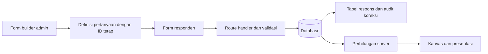

# SurveyDash Studio

Proyek Next.js baru untuk mengelola seluruh proses survei dalam satu website: pembuat form → tabel respons → analisis → presentasi.

Versi online untuk pengujian: [surveydash-studio.vercel.app](https://surveydash-studio.vercel.app). Pilih **Buat workspace** untuk membuat akun baru. Akun dan data lokal tidak otomatis disalin ke cloud. Workspace baru dimulai kosong. Pilih **Coba contoh SKM** bila ingin mencoba data simulasi, atau langsung buat survei sendiri.

## Jalankan lokal

Memerlukan Node.js **24.15+** dan pnpm. Database lokal memakai `node:sqlite`, sehingga tidak membutuhkan akun layanan cloud untuk mencoba aplikasi.

```powershell
cd C:\Users\Haikal\Documents\GitHub\SurveyDash\surveydash-next
pnpm install
pnpm setup
pnpm dev
```

Buka **http://127.0.0.1:3100**. Pilih **Buat workspace** untuk membuat akun Anda. Contoh SKM tersedia melalui tombol **Coba contoh SKM** di beranda. Contoh memakai 48 respons simulasi berlabel, bukan hasil penelitian atau data DAMKAR yang sebenarnya.

Di Windows pada komputer ini, dependencies dan database sudah disiapkan. Anda juga dapat menjalankan **`start.cmd`** dari folder proyek untuk membuka server lokal tanpa mengetik perintah pnpm. Launcher menggunakan runtime Node.js Codex jika tersedia. Biarkan terminalnya terbuka selama memakai aplikasi.

Database dan rahasia sesi lokal ada pada `.data/` dan `.env.local`, keduanya diabaikan Git. Buat akun sendiri melalui **Buat workspace**.

`pnpm setup` membuat `.env.local` dengan rahasia acak jika belum ada, lalu memigrasikan tabel autentikasi. Menjalankannya kembali mempertahankan database dan akun yang ada.

## Fitur yang sudah bekerja

- Autentikasi email/kata sandi dengan Better Auth, authenticator dua langkah dan kode cadangan. Workspace bersama mendukung Pemilik, Editor, Pembaca dan Koordinator lapangan dengan pemeriksaan akses di server.
- Portal Surveyor terpisah dengan username, profil rekening privat, tugas baca saja, dan link atribusi pribadi. Pengelola membuka menu **Surveyor** → memilih survei → **Undang Surveyor**, lalu mengirim link; penerima daftar/masuk dan memilih **Bergabung**. Login ringkas dan pendaftaran Surveyor dibagi dua langkah. Data/CSV mencatat sumber setiap respons; Cleaning data menyediakan pemeriksaan kemiripan dan tinjauan manual. Detail penggunaan, batas, dan status rilis: [alur Surveyor](docs/SURVEYDASH_SURVEYOR_WORKFLOW.md).
- Template SKM, evaluasi layanan, kepuasan pelanggan dan form kosong. Form, layout, paket survei dan dokumen slide dapat disimpan, dipratinjau, dipakai ulang, diduplikasi, diubah namanya, diarsipkan dan dipulihkan.
- Pembuat pertanyaan: teks, paragraf, pilihan tunggal/jamak, skala penilaian, angka, dan tanggal. Satu pertanyaan dibuka saat diedit; tambah langsung, duplikat di bawah asal, urutkan, atau tempel daftar pilihan sekaligus.
- Form publik tanpa login/tutorial: bagian/halaman, pertanyaan bersyarat dari jawaban sebelumnya, validasi, pemulihan draft perangkat maksimal empat jam dan kunci pengiriman stabil untuk retry. Pemulihan meminta pilihan lanjut atau mulai kosong.
- Status **Draft / Buka / Tutup**, terpisah dari visibilitas **Publik / Link saja / Privat**. Publik masuk portal; link saja tersembunyi dari portal; privat tidak bisa diakses melalui link responden.
- Tabel respons dengan pencarian, pengurutan dan pagination di server, pilihan kolom, koreksi sel, dan **Unduh data → Excel (.xlsx) / CSV**, meliputi seluruh hasil pencarian. Excel mempertahankan angka dan teks berawalan nol. Koreksi menyimpan nilai sebelum/sesudah serta memakai revision untuk mendeteksi konflik.
- Analisis demografi, distribusi jawaban, capaian target, dan IKM. IKM hanya berlaku pada survei SKM dengan sembilan unsur. Nilai kosong tidak diberi skor 1.
- Studio slide 16:9 dengan teks, bentuk, gambar, chart/tabel, metrik terikat data, drag/resize, lapisan, undo/redo, autosave, tema dan pratinjau. Ekspor PDF/PPTX gambar mempertahankan tampilan; tersedia juga PPTX editable dengan teks dan chart Office asli. Font/layout editable dapat berbeda.
- Cleaning membedakan respons diterima, perlu verifikasi dan dikeluarkan. Dataset mentah/diterima berlaku pada analisis, ekspor, peta dan refresh presentasi. Koreksi membuat review revisi lama tidak berlaku. Tersedia filter tanggal WIB/provinsi/surveyor, tabulasi silang, bobot manual dan dataset final immutable dengan catatan metode serta CSV.
- Operasi lapangan: koordinator, target tugas, catatan kota/kecamatan, kualitas respons, aktivitas terakhir dan rekap honor manual. Blacklist workspace/platform memakai alasan dan audit. Respons baru menyimpan snapshot wilayah tugas; data lama tanpa snapshot tetap belum terpetakan.
- Presentasi dapat diarsipkan dan dipulihkan. Tombol **Bagikan** mengaktifkan link viewer tanpa login untuk versi slide yang sudah ditinjau. Perubahan editor tampil setelah **Perbarui versi berbagi**. Cabut link kapan saja; arsip presentasi dan sampah survei juga mencabutnya.
- Beranda dengan starter template dan tabel survei; pencarian, duplikat, arsip, sampah dan pemulihan.
- Pengaturan nama dan foto profil privat, identitas workspace, dan impor Google Form JSON dengan preview serta catatan item yang tidak didukung. Menu langganan, plan, dan tagihan disembunyikan sementara.
- Pemulihan password melalui SMTP dan sambungan Google Forms API tersedia setelah konfigurasi pengelola. **Impor Google Form** membuat survei baru dengan pertanyaan dan jawaban historis, setelah pratinjau. Data asli yang belum didukung tetap disimpan privat dan disertakan dalam unduhan. Konfigurasi dan batas ada di [panduan integrasi](docs/SURVEYDASH_INTEGRATIONS.md).
- Navigasi publik sticky dengan menu mobile dan kontak support `help@surveydash.id`.
- PostgreSQL untuk deployment Vercel; SQLite sebagai pilihan lokal tanpa layanan cloud.

## Cara mencoba satu alur lengkap

1. Buat survei dari template **Pengalaman layanan** atau **Form kosong**.
2. Atur pertanyaan; editor menyimpan otomatis dan menampilkan statusnya.
3. Pada tab **Form**, klik **Buka form**. Salin link dan isi dari tab baru.
4. Pada tab **Data**, muat ulang. Respons muncul sebagai baris baru. Aktifkan **Koreksi data** bila perlu; lihat riwayatnya.
5. Pada tab **Presentasi**, pilih **Buat dari analisis** atau **Presentasi kosong**. Atur teks/grafik/gambar, posisi dan ukuran pada editor slide.
6. Klik **Pratinjau** untuk menampilkan slide, gunakan panah, lalu Escape untuk keluar. **Ekspor** menyediakan PDF dan PowerPoint. **Template** menyimpan desain untuk digunakan kembali.
7. Ubah status menjadi **Tutup**, simpan, lalu buka lagi link form. Pengiriman jawaban baru akan ditolak oleh server.

## Fondasi arsitektur



- `src/lib/model.ts`: validasi, distribusi, kebijakan form, dan perhitungan murni.
- `src/lib/repository.ts`: penyimpanan, ownership, revisi, transaksi, template, dan audit.
- `src/lib/db.ts`: koneksi PostgreSQL/SQLite, transaksi per koneksi, dan skema aplikasi.
- `src/lib/auth.ts`: konfigurasi Better Auth; tabel dikelola melalui migrasi library.
- `src/app/api/`: batas server untuk autentikasi, survei, respons, dan portal.
- `src/components/`: workspace, builder, tabel, grafik, dan presentasi.
- `tests/`: pengujian perhitungan, validasi, akses form, ownership, transaksi, dan konflik revisi.

Jawaban menyimpan snapshot pertanyaan. Label dan urutan pertanyaan tidak menjadi indeks data. Setelah respons terkumpul, perubahan jenis, pilihan, skor, atau penghapusan pertanyaan lama ditolak. Pertanyaan baru dan perubahan urutan/label tetap didukung. Buat survei baru untuk mengganti instrumen penelitian.

## Pemeriksaan

```powershell
pnpm lint
pnpm typecheck
pnpm test
pnpm build
```

## Batas versi pertama

Versi online memakai PostgreSQL melalui Prisma Postgres di Vercel Marketplace. Produksi memakai `DATABASE_URL`. Preview wajib memakai `STAGING_DATABASE_URL` yang terpisah untuk seluruh data dan autentikasi. Deployment Vercel menolak fallback SQLite agar data tidak ditulis ke filesystem sementara.

Tabel berfokus pada jawaban survei. Formula Excel bebas dan copy-paste banyak sel belum tersedia. Impor Google Forms/Sheets membuat survei baru dengan pertanyaan dan respons yang dipratinjau dahulu. Penyegaran memakai **Muat ulang**; operasi lapangan juga menyegarkan saat halaman terlihat. Tidak ada subscription realtime.

Pendaftaran workspace terbuka untuk pengujian. Pemulihan password dan verifikasi email memerlukan SMTP operator; kode tersedia tidak berarti pengiriman produksi aktif. Undangan berlaku tujuh hari dan dikelola pemilik/admin. Analisis, ekspor dan backup diproses per batch. Cleaning membuat indeks bertahap dan belum memiliki SLA nasional. `TRUST_PROXY=true` hanya untuk proxy tepercaya.

## Deployment cloud

Project Vercel **surveydash-studio** membangun folder `surveydash-next` pada repository SurveyDash. Database **surveydash-studio-db** menggunakan paket gratis Prisma Postgres di Singapura dan terpisah dari database aplikasi lain.

Branch production: `codex/surveydash-studio`. Push ke branch ini memicu deployment otomatis pada project Studio. Folder `surveydash-next` menyimpan aplikasi baru; root repository tetap berisi aplikasi sebelumnya.

Konfigurasi server: `DATABASE_URL`, `BETTER_AUTH_SECRET`, `BETTER_AUTH_URL`, dan `TRUST_PROXY`. Rahasia disimpan di environment Vercel dan tidak masuk Git. Jangan menambahkan prefix `NEXT_PUBLIC_` pada kredensial database atau rahasia sesi.

Untuk setup awal gunakan `pnpm setup`. Upgrade cloud memerlukan backup terenkripsi dan fingerprint target privat; ikuti [runbook audit](docs/SURVEYDASH_AUDIT_RUNBOOK.md), lalu:

```powershell
node --env-file=.env.cloud.local --import tsx scripts/migrate.ts production
```

Migrasi membuat skema aplikasi dan tabel Better Auth. Migrasi tidak berjalan pada setiap request atau build. Setiap preview deployment mempercayai hostname deploymentnya sendiri; production memakai URL kanonis dari `BETTER_AUTH_URL`.

## Sumber open source dan desain

Referensi dipilih dari dokumentasi resmi dan repositori dengan lisensi MIT, MIT-0 dan Apache-2.0. Aplikasi disusun untuk kebutuhan SurveyDash; tidak menyalin seluruh template aplikasi pihak ketiga.

| Sumber                                                                                         | Pemakaian                                                                                     |
| ---------------------------------------------------------------------------------------------- | --------------------------------------------------------------------------------------------- |
| [Next.js](https://github.com/vercel/next.js)                                                   | App Router, halaman server, dan route handlers                                                |
| [Better Auth](https://github.com/better-auth/better-auth)                                      | Autentikasi dan sesi di database aplikasi                                                     |
| [TanStack Table](https://github.com/TanStack/table)                                            | Tabel respons; versi 8 dipin sesuai API yang digunakan                                        |
| [React Grid Layout](https://github.com/react-grid-layout/react-grid-layout)                    | Grid presentasi v2, drag, resize, dan external drop                                           |
| [Recharts](https://github.com/recharts/recharts)                                               | Grafik analisis dan aktivitas; grafik kanvas memakai CSS native agar stabil saat resize/modal |
| [shadcn/ui](https://github.com/shadcn-ui/ui), [dashboard blocks](https://ui.shadcn.com/blocks) | Referensi komposisi workspace, sidebar, kartu, dan tabel                                      |
| [Radix Primitives](https://github.com/radix-ui/primitives)                                     | Dialog dengan pengelolaan fokus dan navigasi keyboard                                         |
| [dnd kit](https://github.com/clauderic/dnd-kit)                                                | Referensi riset reorder; versi ini memakai drag HTML dan tombol keyboard                      |

Lisensi masing-masing dependency tetap menjadi milik pengembangnya. Detail tersedia di paket yang diinstal dan berkas [THIRD_PARTY_NOTICES.md](THIRD_PARTY_NOTICES.md).

## Dokumentasi rilis produk

Status terbaru ada pada [pengerjaan audit](docs/SURVEYDASH_AUDIT_IMPLEMENTATION.md), [arsitektur](docs/SURVEYDASH_ARCHITECTURE.md) dan [runbook audit](docs/SURVEYDASH_AUDIT_RUNBOOK.md). Dokumen rilis lama menyimpan bukti historis. SMTP/OAuth memerlukan konfigurasi eksternal; aplikasi mencatat honor, tanpa melakukan transfer.

## Admin dan akun client uji

Admin platform yang ditetapkan pengelola memiliki menu **Admin workspace** untuk memilih workspace. Akun login dan profil tetap milik admin tersebut. Banner mode admin menyediakan tombol kembali ke workspace sendiri. Akun client memiliki akses semua fitur pada workspace uji terpisah; data simulasi, template dan slide awal disiapkan tanpa menyalin jawaban produksi.
