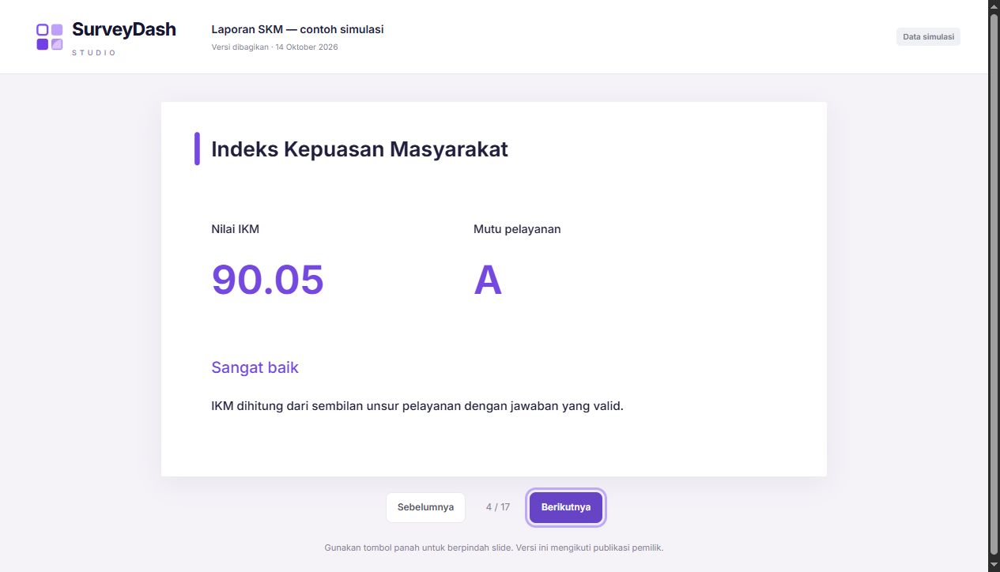

# Implementation report

## Production approval and data preservation — 20 October 2026

The user explicitly authorized production release with visual QA to follow. The previous visual release hold below is historical and is superseded only for this approved rollout; no browser/Lighthouse/WCAG verification is claimed. Before release, production was privately backed up and migrated additively. Every row across all 15 existing tables stayed identical, including 23 surveys, 199 responses and all 7 users/accounts. Eight new feature tables and the response-order index were verified ready. Existing passwords/sessions and survey data were preserved. Final deployment/HTTP verification is recorded on PR #2 and ignored release reports; SMTP and Google provider features remain gated.

## Compact home and hidden subscriptions — 20 October 2026

Public home is reduced to two role cards, each with Masuk/Daftar, and a respondent link. Plan navigation, the sidebar plan/upgrade card, subscription/billing settings tiles and pricing sitemap entry are removed. Pricing and old subscription/billing URLs temporarily redirect to home/settings. The Studio layout no longer loads usage solely for the removed plan card. Internal capacity checks and data remain unchanged. The production deployment is still `1dad32e`; preview pushes do not replace the canonical production URL.

Strict source ESLint, an isolated production build with TypeScript and ten local HTTP checks passed, including both role choices, missing plan/upgrade links in authenticated Studio/settings, sitemap omission, and temporary redirects on old URLs. These are server-output checks, with the existing visual browser gate still outstanding. No new unit tests were added for these reversible display changes. A fresh private read-only production backup was taken; no production schema or data was changed.

## Simple login and Surveyor invitations — 20 October 2026

Login now uses one short form; Surveyor registration separates Account and Bank details into two steps. Labels and actions use plain Indonesian (Username, Email, Masuk, Daftar). Active privacy consent and private payout handling remain enforced. A Surveyor directory is visible in the manager sidebar, overview and editor, scoped to the owned workspace.

Managers select a survey and create/copy a seven-day invitation for manual sharing. Recipients register or sign in, then choose Bergabung; the server assigns the survey and their name appears in the manager list. Invitation capabilities are distinct from respondent links, can be revoked/rotated, and cannot restore a surveyor's disabled assignment. Public invitation metadata is limited to title/institution. No invitation email or message is sent automatically.

Validation: **50 tests, 41 local HTTP checks and 9 isolated PostgreSQL checks passed**, along with strict source lint and an isolated production build including TypeScript. The staging migration added one table after a private backup and verified every row in the 22 pre-existing tables unchanged. Fixtures stayed in local databases or an isolated QA schema, which was removed. Production and visual QA remain held as described below; no browser interaction or layout result is claimed.

## Surveyor and cleaning follow-up — 19 October 2026

Branch `codex/surveyor-workflow` adds distinct Pengelola Survei and Surveyor entry points, server-enforced roles, unique normalized surveyor usernames, and consented profile registration with encrypted bank details and masked account-number responses. Existing accounts remain Pengelola. Surveyors receive only assigned surveys, read questions without editing or respondent-row access, and share personal referral links. Responses retain immutable source snapshots; direct form links remain compatible without attribution, and reactivating a revoked assignment rotates its token.

Pengelola can manage assignments inside an owned survey and review possible duplicates through `/studio/cleaning` and `/studio/[id]/cleaning`. Explicit field mapping, same-survey matching, masked account values, paginated comparison, review reasons, actual-actor audit, and stale-review detection support human decisions. Flags do not automatically delete or exclude responses, change IKM, verify identities or bank ownership, or process incentives.

Validation for this follow-up: **42 tests and 150 local HTTP checks passed** (69 feature, 15 page, 26 core survey and 38 presentation-sharing and 2 admin-role boundary), along with the production build. **34 PostgreSQL checks passed**, using a separate staging QA schema that was subsequently removed and verified absent. Staging was privately backed up before adding six tables; every row in its 16 pre-existing tables was verified unchanged, and no synthetic fixtures were inserted into the public schema.

This branch is held from production release while visual QA remains blocked by the browser tool's saved permission or managed policy despite the user's preview authorization. Production requires its own documented backup, additive migration and preservation checks, stable encryption-key handling, and privacy operations review. No production release or new visual/WCAG/Lighthouse verification is claimed. See [Surveyor workflow](SURVEYDASH_SURVEYOR_WORKFLOW.md), [privacy operations](SURVEYDASH_SURVEYOR_PRIVACY.md), and [route map](SURVEYDASH_ROUTE_MAP.md) for current behavior and operational limits. The evidence below is historical and does not validate this follow-up.

## Master brief revision — 14 October 2026

The follow-up on `codex/surveydash-revisions` adds sticky public navigation with a mobile dialog, a closable contextual slide inspector, detailed presentation preflight, server response pagination/filtering/sorting and streamed all-result CSV. Survey SSR sends metadata rather than all submissions; lazy server insights preserve the original SKM calculations. Profile photos are validated and privately served under the logged-in identity, including during admin workspace switching.

SMTP password recovery and the official read-only Google Forms OAuth connector are implemented with configuration gates. Recovery has been tested through an actual local SMTP connection and HTTP reset flow. Google PKCE/state/encryption/ID validation is tested; real provider consent remains unverified because OAuth credentials are unavailable. The user approved public contact `help@surveydash.id` and asked to prepare SMTP configuration. See `SURVEYDASH_INTEGRATIONS.md` and `SURVEYDASH_REVISION_VALIDATION.md` for setup, evidence and release blockers.

This follow-up is not a production release. New visual QA is blocked by the browser tool's saved permission/managed policy even after explicit user permission. Historical browser/download evidence in the sections below refers to earlier releases; it does not verify the changed inspector or mobile navigation.

## Delivered

- Public product pages, local Inter font, SVG identity, app icon, sitemap/robots and real signup/login entry points.
- Reference-led workspace home with starter templates and recent-survey table; owned search, status filters, sorting, card/table views and pagination.
- Survey duplication, archive, recoverable trash and restore. Archive/trash close the form without deleting answers. Explicit demo creation replaces automatic sample seeding.
- Form autosave and save/error states, question-type selection, existing-response schema protections and preview/share link controls.
- Responses start read-only. Correction mode, details, search, column visibility, CSV and revision/audit behavior remain available. Existing SKM calculations are preserved.
- Form, presentation layout and full survey templates: save, reuse, preview, search, duplicate, rename, archive and restore. New slide templates support question remapping and clean derived data.
- Visual presentation documents: multiple slides, generated survey sections, native text/shapes/charts, image uploads, drag/resize, layer order, slide order, duplicate/delete, undo/redo, keyboard shortcuts, themes, zoom, autosave, conflict handling and arrow-key preview.
- Bound metrics and charts refresh from authoritative stored responses while retaining manual notes and geometry. SKM generation covers every scored element.
- Presentation archive recovery and opt-in read-only public links. Reviewed snapshots remain frozen until republished; revocation, archive and survey trash disable access. Raw answer tables and editor access are excluded. Only images in the reviewed snapshot are exposed.
- PDF and PPTX export with disclosed raster limitations. Actual 13-slide browser downloads were checked for page counts, 16:9 sizing, 1920×1080 media and visual layout.
- Account display-name update, workspace identity, actual monthly usage, honest billing unavailable state, configurable server quotas and Google Form JSON import with unsupported-item review.
- Separate staging database, consistent private backup, empty-target restore with row equality verification, additive migration and recovery documentation.

## Validation

20 model/repository tests passed, including configured quota enforcement, idempotent replay at the limit and presentation-sharing safeguards. Strict ESLint and TypeScript passed. A production build passed. Local staging HTTP smoke passed 26 requests, including authentication, form creation, public submission/idempotency, audited correction, template reuse, slide refresh/conflict rejection, archive rejection and JSON import. Browser checks exercised drag, resize, undo/redo, autosave, template reuse, downloads and mobile layout. Staging restore preserved all original rows. Production verification before migration found 12 original surveys, 147 submissions, 3 audit records, 1 template, 4 users and 4 accounts present and unchanged.

## Limitations at the earlier product release

Google OAuth requires provider credentials, consent configuration and scopes; direct account connection is not enabled. SMTP password recovery and team invitations require an email service. Paid plans need approved prices, a provider and webhook configuration; this release creates no fake invoices or charges.

Collaborative roles/invitations, billing administration and configurable respondent access groups are not implemented. The form builder retains a single ordered question list rather than section branching. Response pagination is client-side over the owned dataset; very large workspaces need server pagination and aggregation. Asset retention is persistent and owner scoped, with no asset deletion screen yet. Exported PDF/PPTX is visual, not searchable text or editable chart objects.

The supplied master document is a product target, not a claim that every roadmap item is available. The working release focuses on the survey/template/presentation ecosystem, while unavailable integrations are identified explicitly.

## Release evidence

Product code commit: e812c2dc4031bb827fcd4a119a80082f829023fd. GitHub push completed on both codex/surveydash-product and codex/surveydash-studio. Preview dpl_4mZt6tNsnGC8ujGdJJFiCETS3qgP and production dpl_8q3T6JTbEUj2MBQQeyGEvtGqFmfC reached Ready. Canonical production URL: https://surveydash-studio.vercel.app.

Production HTTP smoke passed 26 requests. Fourteen public pages/assets returned HTTP 200. Browser production login, the slide editor and 17-slide preview with keyboard navigation were verified without console errors. Preview login and a fixture created in staging confirmed the preview reads the staging database. Cloud image upload and a five-page PDF containing the private image were also verified.

After migration and production smoke, every original survey, submission, audit record, template, user and account remained present and byte-equivalent after normalized serialization. Original 147 submissions were unchanged. Three archived QA surveys, one synthetic response/audit and two archived QA templates were added only under the dedicated test account. Existing accounts were neither replaced nor reset.

## Presentation sharing follow-up

Local staging passed 38 HTTP checks for sharing lifecycle and the existing 26-request survey flow. The browser verified explicit activation, slide/keyboard navigation, 375px layout without horizontal overflow, revocation returning 404, and archive recovery. The SQLite connection applies its busy timeout before switching journal mode so parallel build workers can initialize safely. The production build and all 20 tests passed. Private production backup studio-2026-10-14T06-23-01.608Z.json was created before the follow-up migration; all original rows were still present and unchanged.

## Requested administrator and client access

Platform administrators can select and manage workspaces, while account profile identity stays unchanged and corrections retain the real actor. Normal clients have full product features only in their own workspace. The client test workspace is seeded with labeled simulations, templates and a 17-slide report. Existing passwords are preserved. Credentials are stored privately outside Git. All 21 repository tests passed, including forged-cookie isolation and revoked-role behavior; staging access HTTP checks passed 15 requests and the client survey flow passed 26 requests.

Sharing follow-up deployment: commit 240e56e1949d0ca2e071d8ae99751a8973ba255e; preview dpl_7QE9UGncqMxS5ENQCtDKea7rYN24 and production dpl_2R63dmvH2HkubfPmZMsTTy9gG9w8 Ready. Production sharing smoke passed 38 requests and the 17-slide viewer was checked in the browser. All original rows remained unchanged.

Admin/client release: commit bb0e1f79e2c90ceefcd597cdd08b15d2725b499f. Preview dpl_2jpmGYftPdGK5465NMfE3tcUQxAo and production dpl_Gp4WkGGu3rLinWa7jAZc6PKrhKYr reached Ready. Both requested administrator IDs were provisioned; an existing account password was preserved and the previously absent administrator account was created. The isolated production client login and its 26-request survey flow passed. All rows in the pre-access backup remained unchanged. Browser admin switching and return to the original workspace were verified on production. Sidebar overflow is scrollable on short viewports so added admin navigation cannot obscure account controls.
