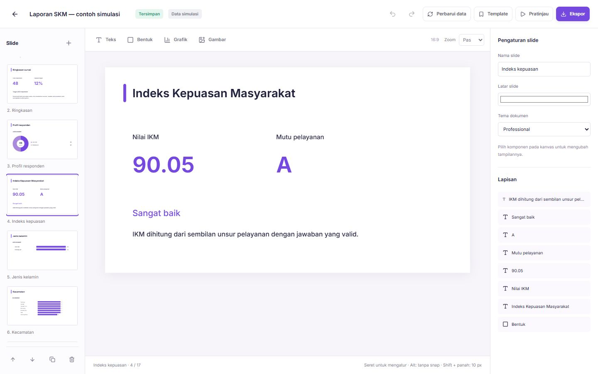

# Implementation report — 14 October 2026

## Delivered

- Public product pages, local Inter font, SVG identity, app icon, sitemap/robots and real signup/login entry points.
- Reference-led workspace home with starter templates and recent-survey table; owned search, status filters, sorting, card/table views and pagination.
- Survey duplication, archive, recoverable trash and restore. Archive/trash close the form without deleting answers. Explicit demo creation replaces automatic sample seeding.
- Form autosave and save/error states, question-type selection, existing-response schema protections and preview/share link controls.
- Responses start read-only. Correction mode, details, search, column visibility, CSV and revision/audit behavior remain available. Existing SKM calculations are preserved.
- Form, presentation layout and full survey templates: save, reuse, preview, search, duplicate, rename, archive and restore. New slide templates support question remapping and clean derived data.
- Visual presentation documents: multiple slides, generated survey sections, native text/shapes/charts, image uploads, drag/resize, layer order, slide order, duplicate/delete, undo/redo, keyboard shortcuts, themes, zoom, autosave, conflict handling and arrow-key preview.
- Bound metrics and charts refresh from authoritative stored responses while retaining manual notes and geometry. SKM generation covers every scored element.
- Presentation archive recovery and opt-in read-only public links. Reviewed snapshots remain frozen until republished; revocation, archive and survey trash disable access. Raw answer tables and editor access are excluded. Only images in the reviewed snapshot are exposed.
- PDF and PPTX export with disclosed raster limitations. Actual 13-slide browser downloads were checked for page counts, 16:9 sizing, 1920×1080 media and visual layout.
- Account display-name update, workspace identity, actual monthly usage, honest billing unavailable state, configurable server quotas and Google Form JSON import with unsupported-item review.
- Separate staging database, consistent private backup, empty-target restore with row equality verification, additive migration and recovery documentation.

## Validation

20 model/repository tests passed, including configured quota enforcement, idempotent replay at the limit and presentation-sharing safeguards. Strict ESLint and TypeScript passed. A production build passed. Local staging HTTP smoke passed 26 requests, including authentication, form creation, public submission/idempotency, audited correction, template reuse, slide refresh/conflict rejection, archive rejection and JSON import. Browser checks exercised drag, resize, undo/redo, autosave, template reuse, downloads and mobile layout. Staging restore preserved all original rows. Production verification before migration found 12 original surveys, 147 submissions, 3 audit records, 1 template, 4 users and 4 accounts present and unchanged.

## Limitations and deferred roadmap

Google OAuth requires provider credentials, consent configuration and scopes; direct account connection is not enabled. SMTP password recovery and team invitations require an email service. Paid plans need approved prices, a provider and webhook configuration; this release creates no fake invoices or charges.

Collaborative roles/invitations, platform admin, billing administration and configurable respondent access groups are not implemented. The form builder retains a single ordered question list rather than section branching. Response pagination is client-side over the owned dataset; very large workspaces need server pagination and aggregation. Asset retention is persistent and owner scoped, with no asset deletion screen yet. Exported PDF/PPTX is visual, not searchable text or editable chart objects.

The supplied master document is a product target, not a claim that every roadmap item is available. The working release focuses on the survey/template/presentation ecosystem, while unavailable integrations are identified explicitly.

## Release evidence

Product code commit: e812c2dc4031bb827fcd4a119a80082f829023fd. GitHub push completed on both codex/surveydash-product and codex/surveydash-studio. Preview dpl_4mZt6tNsnGC8ujGdJJFiCETS3qgP and production dpl_8q3T6JTbEUj2MBQQeyGEvtGqFmfC reached Ready. Canonical production URL: https://surveydash-studio.vercel.app.

Production HTTP smoke passed 26 requests. Fourteen public pages/assets returned HTTP 200. Browser production login, the slide editor and 17-slide preview with keyboard navigation were verified without console errors. Preview login and a fixture created in staging confirmed the preview reads the staging database. Cloud image upload and a five-page PDF containing the private image were also verified.

After migration and production smoke, every original survey, submission, audit record, template, user and account remained present and byte-equivalent after normalized serialization. Original 147 submissions were unchanged. Three archived QA surveys, one synthetic response/audit and two archived QA templates were added only under the dedicated test account. Existing accounts were neither replaced nor reset.

## Presentation sharing follow-up

Local staging passed 38 HTTP checks for sharing lifecycle and the existing 26-request survey flow. The browser verified explicit activation, slide/keyboard navigation, 375px layout without horizontal overflow, revocation returning 404, and archive recovery. The SQLite connection applies its busy timeout before switching journal mode so parallel build workers can initialize safely. The production build and all 20 tests passed. Private production backup studio-2026-10-14T06-23-01.608Z.json was created before the follow-up migration; all original rows were still present and unchanged.
